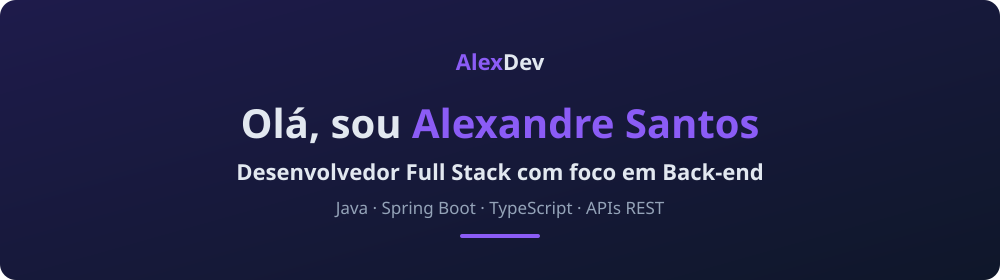
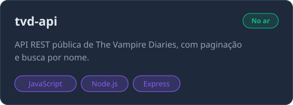
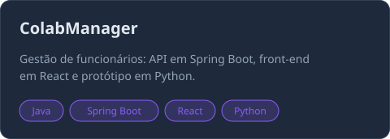
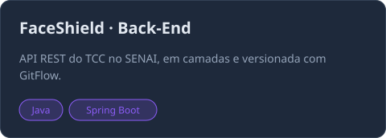
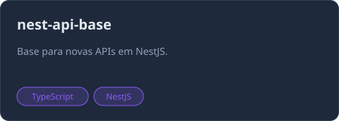
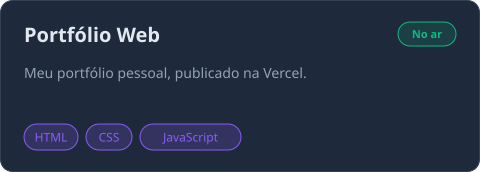

  

  
  
  

<h3 align="center">Sobre Mim</h3>

Desenvolvedor full stack em formação, com foco em back-end: **Java, Spring Boot e APIs REST**. Técnico em Desenvolvimento de Software pelo **SENAI-SP**, com passagem como aprendiz na **Tecumseh do Brasil**.

Curso **Tecnologia em Sistemas para Internet no IFSP** e sou **Estagiário de Implantação na Visio.ai**, onde acompanho a solução chegando ao cliente. Isso mudou a forma como penso arquitetura, tratamento de erros e experiência de uso.

- 🌱 Foco: APIs REST com **Spring Boot** e **NestJS** e modelagem de dados
- 📍 São Carlos, SP
- 💬 Aberto a conversar sobre back-end, projetos e oportunidades

<h3 align="center">Habilidades e Ferramentas</h3>

  <b>Back-End</b> 
  

  <b>Banco de dados</b> 
  

  <b>Front-End</b> 
  

  <b>Ferramentas</b> 
  

Também: <b>SQL Server</b> e <b>GitFlow</b>.

<h3 align="center">Meus Projetos</h3>

  
  
  
  
  

<a href="https://tvd-api.vercel.app/api">tvd-api no ar</a> · <a href="https://portifolio-web-alexsantos.vercel.app">Portfólio no ar</a>

<h3 align="center">Experiência</h3>

- **Visio.ai** · Estagiário de Implantação *(set/2026 a atual)*
  Implantação em clientes do varejo: configuração, validação, suporte e treinamento de usuários.
- **Visio.ai** · Analista de Vídeos para Controle de Vendas *(mai/2026 a set/2026)*
  Classificação de gravações e validação dos resultados do sistema.
- **Tecumseh do Brasil** · Aprendiz em Programação de Software *(jul/2024 a dez/2025)*
  Front-end com React, infraestrutura de TI e HelpDesk.

<h3 align="center">Estatísticas</h3>

  

